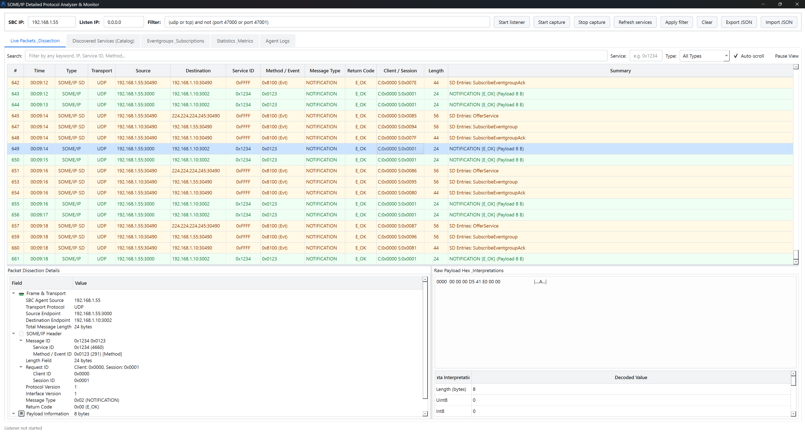

# SOME/IP Monitor & Detailed Protocol Analyzer

A complete, high-performance tooling suite for capturing, dissecting, and analyzing **AUTOSAR SOME/IP** and **SOME/IP-SD** traffic across embedded targets (**Linux** and **QNX Neutrino RTOS 7.x / 8.0**) and monitoring on a PC.

---

## Architecture Overview

```
+--------------------------------------------------------------+
|                     Target SBC / ECU                         |
|  +--------------------------------------------------------+  |
|  |                 sbc_agent (C++17)                      |  |
|  |                                                        |  |
|  |  +---------------------+      +---------------------+  |  |
|  |  |  PcapCaptureBackend |      | QnxBpfCaptureBackend|  |  |
|  |  |   (Linux / QNX)     |      |  (Native QNX /dev/bpf) |  |
|  |  +----------+----------+      +----------+----------+  |  |
|  |             \                            /             |  |
|  |              +------------+-------------+              |  |
|  |                           |                            |  |
|  |             +-------------v-------------+              |  |
|  |             |      SomeIpDissector      |              |  |
|  |             |  - Header / TP / SD / VLAN|              |  |
|  |             +-------------+-------------+              |  |
|  |                           |                            |  |
|  |                           v                            |  |
|  |            Control Port (UDP 47000)                    |  |
|  |            Telemetry Port (UDP 47001)                  |  |
|  +---------------------------+----------------------------+  |
+------------------------------|-------------------------------+
                               | Rich JSON Telemetry
                               v
+--------------------------------------------------------------+
|                       Host PC Monitor                        |
|  +--------------------------------------------------------+  |
|  |                 pc_monitor (Python/PySide6)            |  |
|  |                                                        |  |
|  |  - Wireshark-Grade Packet Dissection Tree              |  |
|  |  - Hex Dump & Payload Data Type Interpretations        |  |
|  |  - Discovered Services Catalog (TTL countdown)         |  |
|  |  - Eventgroup Subscriptions Tracker                    |  |
|  |  - Live KPIs & Throughput Statistics                   |  |
|  |  - Search, Service/Method Filter & JSON Export         |  |
|  |                                                        |  |
|  |  +--------------------------------------------------+  |  |
|  |  | someip_decoder.py (Standalone Decoder Engine)    |  |  |
|  |  +--------------------------------------------------+  |  |
|  +--------------------------------------------------------+  |
+--------------------------------------------------------------+
```

---

## Detailed Protocol Analysis Capabilities

Both the C++ agent and Python tools provide full dissection according to the **AUTOSAR SOME/IP & SOME/IP-SD** specifications:

### 1. SOME/IP Protocol Dissection
- **Message ID (32-bit)**:
  - **Service ID (16-bit)** (e.g. `0x1234`)
  - **Method ID / Event ID (16-bit)**: Distinguishes between Method (bit 15 = 0) and Event (bit 15 = 1).
- **Length Field (32-bit)**: Total length of payload starting from Client ID.
- **Request ID (32-bit)**:
  - **Client ID (16-bit)**
  - **Session ID (16-bit)**
- **Protocol Version (8-bit)** & **Interface Version (8-bit)**
- **Message Types (8-bit)**:
  - `REQUEST (0x00)`, `REQUEST_NO_RETURN (0x01)`, `NOTIFICATION (0x02)`, `RESPONSE (0x80)`, `ERROR (0x81)`
  - Transport Protocol segmented messages: `TP_REQUEST (0x20)`, `TP_NOTIFICATION (0x22)`, `TP_RESPONSE (0x23)`, etc.
- **Return Codes (8-bit)**:
  - `E_OK (0x00)`, `E_NOT_OK (0x01)`, `E_UNKNOWN_SERVICE (0x02)`, `E_UNKNOWN_METHOD (0x03)`, `E_NOT_READY (0x04)`, `E_NOT_REACHABLE (0x05)`, `E_TIMEOUT (0x06)`, etc.
- **SOME/IP-TP (Transport Protocol) Header (4-byte)**:
  - Offset in bytes (`offset_field * 16`)
  - More Segments flag (`True` / `False`)
- **Multi-PDU Unwrapping**: Handles multiple SOME/IP messages inside a single UDP packet or TCP segment.
- **Link Layer**: Supports standard Ethernet II and **802.1Q VLAN tagged frames**.

### 2. SOME/IP-SD (Service Discovery) Dissection
- **SD Header**:
  - Flags: **Reboot flag**, **Unicast flag**, Explicit initial data control.
- **Entries**:
  - `FindService (0x00)`
  - `OfferService (0x01)` (TTL > 0 = Offer, TTL == 0 = StopOfferService)
  - `SubscribeEventgroup (0x06)` (TTL > 0 = Subscribe, TTL == 0 = StopSubscribeEventgroup)
  - `SubscribeEventgroupAck (0x07)` (TTL > 0 = Ack, TTL == 0 = Nack)
  - Minor Version (Service entries) & Eventgroup ID, Counter, Initial Data Requested (Eventgroup entries)
- **Options**:
  - `IPV4_ENDPOINT (0x04)`: IPv4 Address, Protocol (UDP/TCP), Port
  - `IPV6_ENDPOINT (0x06)`: IPv6 Address, Protocol, Port
  - `IPV4_MULTICAST (0x14)`, `IPV6_MULTICAST (0x16)`
  - `CONFIGURATION (0x01)`: Configuration key/value strings
- **Entry-to-Option Resolution**: Automatically links each entry to its referenced endpoints.

---

## SBC Agent: Linux & QNX Neutrino RTOS Support

The C++ agent (`sbc_agent`) features a pluggable capture backend architecture (`ICaptureBackend`):
1. **`PcapCaptureBackend`**: Uses `libpcap` on Linux and QNX (when pcap is present).
2. **`QnxBpfCaptureBackend`**: Native QNX BSD Packet Filter (`/dev/bpf`) backend. Operates directly on QNX `io-sock` without requiring any external libraries!

### Linux Build (Host or SBC)
You can use the helper script or CMake directly:
```bash
# Using the build script (from root or sbc_agent):
./build_linux.sh

# Or with options:
./build_linux.sh --clean --build-type Release -j 8

# Run the agent:
sudo ./sbc_agent/build/someip_agent --iface eth0 --pc-ip 192.168.1.10
```

### QNX Neutrino RTOS Build (SDP 7.0 / 7.1 / 8.0)
A dedicated QNX toolchain file is included at `sbc_agent/cmake/qnx_nto_toolchain.cmake`.

Using the automated build script:
```bash
# 1. Source your QNX SDP environment (or pass --sdp-path):
source /opt/qnx710/qnxsdp-env.sh

# 2. Build for aarch64 (or x86_64 / armv7):
./build_qnx.sh --arch aarch64

# Or specify SDP path directly:
./build_qnx.sh --arch aarch64 --sdp-path /opt/qnx710

# 3. Transfer binary to QNX target and run:
scp sbc_agent/build_qnx_aarch64/someip_agent qnx-target:/tmp/
# On QNX target (using native /dev/bpf capture):
/tmp/someip_agent --iface dmfe0 --pc-ip <PC_IP> --backend bpf
```

### SBC Agent Command-Line Options
```
Usage: someip_agent [options]

Options:
  --iface <iface>          Network interface to monitor (default: eth0)
  --pc-ip <ip>             IP address of monitoring PC (default: 192.168.1.10)
  --control-port <port>    UDP port for incoming control commands (default: 47000)
  --telemetry-port <port>  UDP port for telemetry stream to PC (default: 47001)
  --backend <auto|pcap|bpf> Capture backend (default: auto)
  --preview-len <bytes>    Max payload bytes previewed in hex (default: 256)
  --help                   Display this help message
```

---

## PC Monitor GUI



### Run the GUI
```bash
# Activate virtual environment if desired:
python -m pip install PySide6
python pc_monitor/main.py
```

### Build Windows Executable (.exe)
You can build a standalone Windows `.exe` using PyInstaller and the provided spec file:
```cmd
pip install pyinstaller PySide6
build_windows.bat
```
The output executable will be generated at `dist/SomeipMonitor/SomeipMonitor.exe`.

### Key Features
1. **Live Packets & Dissection Tab**:
   - **Packets Table**: Displays all captured frames with color-coding (Gold for SD, Green for Notifications, Blue for Requests/Responses, Red for Errors).
   - **Packet Dissection Details**: Collapsible tree inspector detailing Frame, SOME/IP Header, SOME/IP-TP segments, and SOME/IP-SD flags/entries/options.
   - **Hex Dump & ASCII View**: Monospace formatted hex view with byte offsets.
   - **Payload Data Interpreter**: Automatically decodes payload bytes as `Uint8/16/32/64`, `Int8/16/32`, `Float32/64`, ASCII strings, and sensor patterns (e.g. `>If` counter + temperature).
2. **Discovered Services Catalog Tab**:
   - Live table of offered services, instance IDs, major/minor versions, resolved endpoint IP:Port, transport protocol, and active TTL countdown.
3. **Eventgroups & Subscriptions Tab**:
   - Tracks active eventgroup subscriptions, subscriber IP:Port, and acknowledgment state.
4. **Statistics & Metrics Tab**:
   - Real-time KPIs for total packets, message types, error counts, and packet rates (pkts/sec).
5. **Real-Time Filtering & Search**:
   - Filter by keyword, Service ID (e.g. `0x1234`), Method ID, or Message Type dropdown (`SOME/IP Only`, `SOME/IP-SD Only`, `REQUEST`, `RESPONSE`, `NOTIFICATION`, `ERRORS`).
   - Pause view and Auto-scroll toggles.
6. **Export & Import JSON**:
   - **Export JSON**: Export captured packet sessions to timestamped JSON files for offline analysis and playback.
   - **Import JSON**: Load previously captured JSON files into the monitor to inspect packets, services, and statistics offline.

---

## Standalone Python Decoder Module (`someip_decoder.py`)

Can be used in custom automation scripts, CI/CD, or offline PCAP parsers:
```python
from pc_monitor.someip_decoder import decode_someip, format_hex_dump, interpret_payload

raw_bytes = bytes.fromhex("123400010000001000010042010100000000002a41bc0000")
messages = decode_someip(raw_bytes)

for msg in messages:
    print(f"Service: 0x{msg.header.service_id:04X}, Method: 0x{msg.header.method_id:04X}")
    print(f"Type: {msg.header.message_type.name}, Return Code: {msg.header.return_code.name}")
    print("Hex dump:\n" + format_hex_dump(msg.payload))
    print("Interpreted fields:", interpret_payload(msg.payload))
```

---

## Running the Automated Test Suites

### C++ Dissector Tests
```bash
cd sbc_agent
g++ -std=c++17 -Wall -Wextra -I include src/someip/someip_dissector.cpp tests/test_dissector.cpp -o test_dissector
./test_dissector
```

### Python Unit Tests
```bash
python -m unittest tests/test_someip_decoder.py
```
